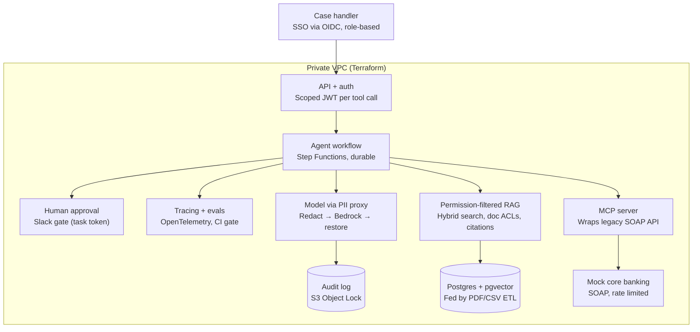

# Architecture

AI case-handling assistant for a (mock) UK lender's complaints team.

## Key decisions

| Decision | Why |
|---|---|
| Step Functions over Temporal | AWS-native, durable by default, task tokens give a clean human-approval pause |
| Bedrock via VPC endpoint | Model traffic never leaves the private network |
| PII redaction before the model | Consistent placeholder tokens let the model reason about "Customer A" without seeing real data |
| Permission filter applied at query time | Users can only retrieve documents their role allows; no post-hoc filtering |
| S3 Object Lock for audit | The audit trail can't be altered, which matters in a regulated setting |

## Numbers

<!-- Fill in once measured -->
| Metric | Value |
|---|---|
| p50 / p95 latency per case | |
| Cost per case | |
| Eval pass rate (golden set) | |
| Abstention accuracy | |
